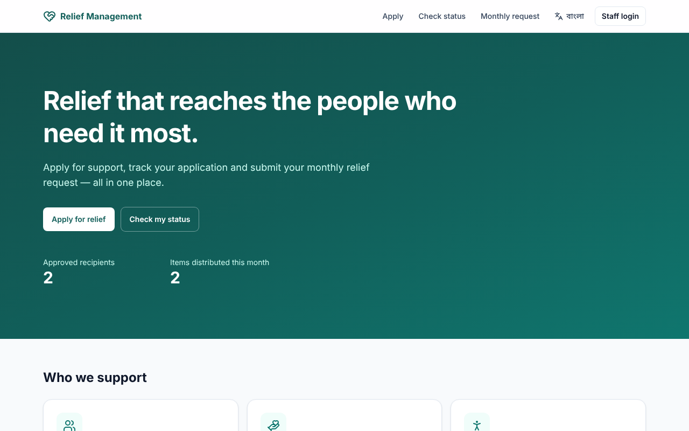
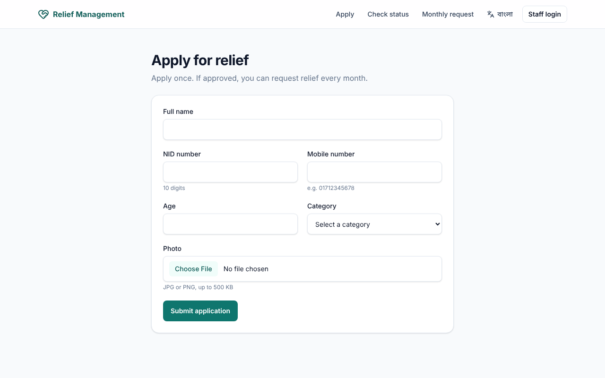
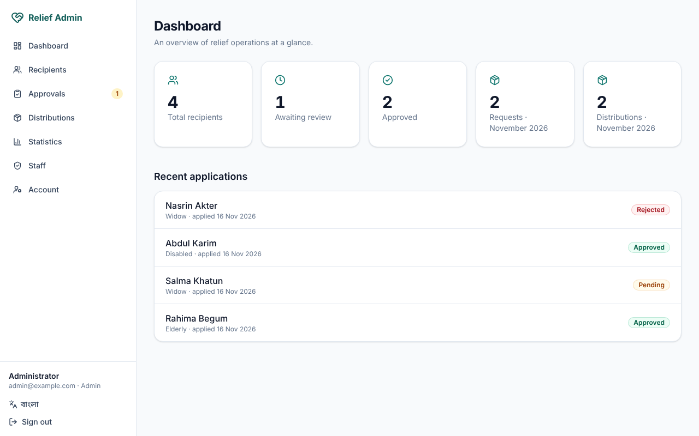
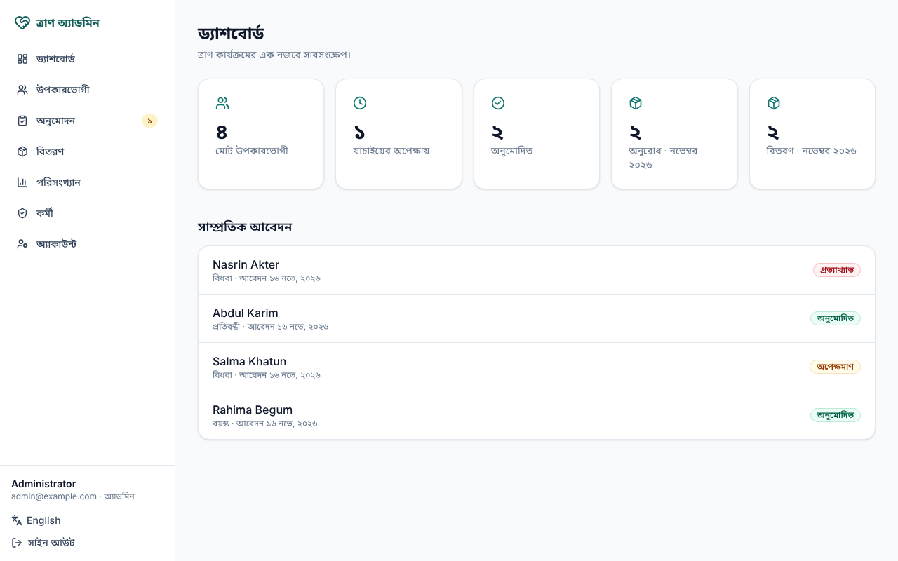
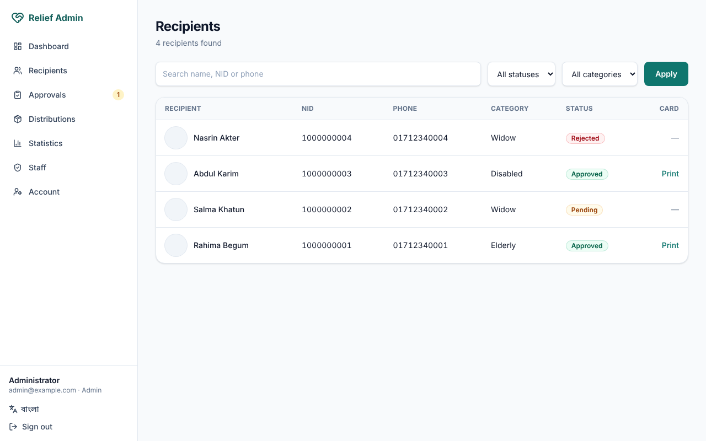
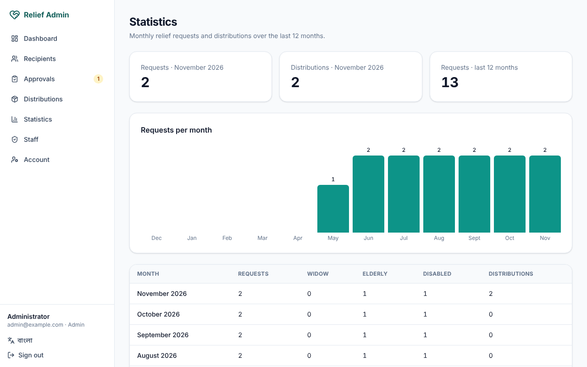
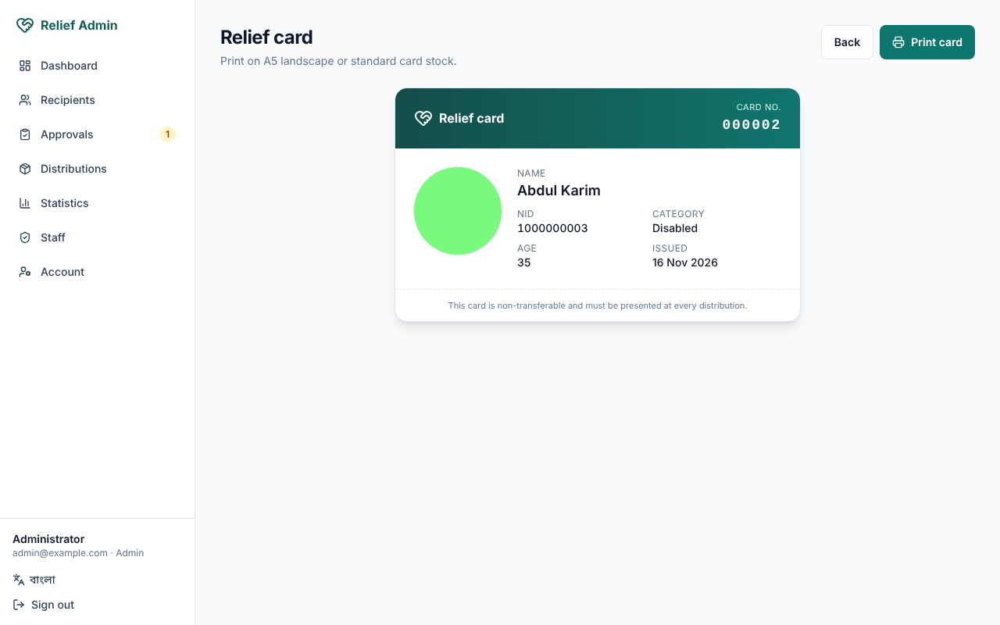

# Relief Management System · ত্রাণ ব্যবস্থাপনা সিস্টেম

A web application for running a relief program for **widows, the elderly and people with disabilities**: public applications, staff review and approval, relief cards, monthly requests, item distribution and reporting. Available in **English and Bangla (বাংলা)**.

**Live demo:** https://relief-management-system.vercel.app

| Home | Apply |
| --- | --- |
|  |  |

| Dashboard | Dashboard in Bangla |
| --- | --- |
|  |  |

| Recipients | Statistics | Relief card |
| --- | --- | --- |
|  |  |  |

> **v2** is a full rewrite of the original PHP/MySQL university project (see git history for v1). It adds authentication and roles, database-enforced business rules, rate limiting, a Bangla/English UI, an accessible responsive design and a deployable Node stack.

## Features

**Public** (no login)
- Apply for relief with NID, phone and photo — validation messages keep what you typed
- Check application status (verified with NID **and** phone, so NIDs can't be probed)
- Submit one monthly request, with a live countdown to the next eligible date

**Staff / Admin** (login required)
- Dashboard with live counts and recent applications
- Recipients: search, filter by status/category, pagination, edit, photo replacement
- Approvals queue — approving issues a numbered relief card automatically
- Printable relief cards (print stylesheet included)
- Distributions: one record per item per recipient per month
- Statistics: 12-month request chart with per-category breakdown
- **Staff management (admin):** create accounts, deactivate (signs the user out immediately), reset passwords
- Change your own password; temporary passwords must be replaced
- Audit log of every sensitive action; admin-only deletes

## Business rules (enforced in the database, not just the UI)

| Rule | How |
| --- | --- |
| One request per recipient per month | `UNIQUE (recipientId, period)` |
| Same item once per recipient per month (case/spacing-insensitive) | `UNIQUE (recipientId, itemKey, period)` |
| Only approved recipients can request or receive items | checked in server actions |
| Elderly recipients must be 60+ | zod schema |
| Months follow Bangladesh time (Asia/Dhaka) | `src/lib/period.ts` (unit-tested) |

## Stack

Next.js 15 (App Router, Server Actions) · TypeScript · Tailwind CSS 4 · Prisma 6 · SQLite locally / [Turso](https://turso.tech) (libSQL) in production · zod · jose + bcrypt for sessions · Vitest + Playwright

## Getting started (local)

```bash
cp .env.example .env          # defaults work: a local SQLite file
npm install
npx prisma migrate dev        # creates prisma/dev.db and seeds the first admin
npm run dev                   # http://localhost:3000
```

Sign in at `/login` with `SEED_ADMIN_EMAIL` / `SEED_ADMIN_PASSWORD` from your `.env`. The seeded admin is asked to choose their own password straight away (**Account** page).

## Deploying (Vercel + Turso)

1. Create a Turso database (`turso db create relief`) and a database token (`turso db tokens create relief`).
2. In Vercel set `TURSO_DATABASE_URL`, `TURSO_AUTH_TOKEN`, `SESSION_SECRET` (`openssl rand -base64 32`), `SEED_ADMIN_EMAIL` and `SEED_ADMIN_PASSWORD`. Optionally set `NEXT_PUBLIC_SITE_URL` for a custom domain (sitemap and Open Graph).
3. Deploy. The `vercel-build` script generates the Prisma client, applies migrations to Turso (`scripts/migrate-turso.mjs`, idempotent), seeds the admin if missing, then builds.
4. Point an uptime monitor at `/api/health` (200 when the database is reachable, 503 otherwise).

Turso is accessed over HTTPS through Prisma's libSQL adapter, so no native modules or writable disk are needed. Photos are stored in the database (≤ 500 KB each).

## Scripts

| Script | What it does |
| --- | --- |
| `npm run dev` / `build` / `start` | Develop, build and serve |
| `npm run lint` / `typecheck` | ESLint and TypeScript |
| `npm test` | Unit tests (Vitest), including the rate limiter running through the libSQL adapter |
| `npm run test:e2e` | Browser tests (Playwright) against a fresh SQLite database — run `npm run build` first |
| `npm run db:migrate` / `db:seed` | Create a migration / seed the admin |

CI (`.github/workflows/ci.yml`) runs lint, typecheck, unit tests, build and the E2E suite on every push and pull request.

## Languages

The whole UI — public pages, admin, validation and error messages, dates and numbers — is available in English and Bangla. The default follows the browser's `Accept-Language`; the switcher stores the choice in a cookie. Strings live in `src/lib/i18n/en.ts` and `bn.ts`; the Bangla dictionary is type-checked against the English keys, and a test fails if a key or `{placeholder}` is missing in either language. To add a string, add it to both files and use `t("key")` (`getT()` on the server, `useT()` in client components).

## Rate limiting

Counters live in the database (serverless instances share no memory) as atomic fixed-window upserts:

| Endpoint | Limit |
| --- | --- |
| Login | 10 / 15 min per IP, 8 / 15 min per email (both cleared on success) |
| Apply | 5 / hour per IP |
| Status check, monthly request | 10 / 15 min per IP and per NID (stops phone brute-forcing) |
| Change password | 5 / 15 min per user |

Limits fail open if the database errors, so a limiter fault never takes the site down. Tune them where `rateLimit(...)` is called in `src/app/actions/`.

## Security notes

- All queries go through Prisma (parameterised); inputs are validated with zod on the server
- Sessions are signed, HTTP-only, SameSite=Lax cookies; the user is re-checked against the database on every request, so deactivation takes effect immediately
- Server Actions provide built-in CSRF protection (origin checking)
- Uploads are checked by size, declared type **and** magic bytes; photos are only served to signed-in staff
- Passwords: bcrypt (cost 12), 8–72 characters, never echoed back to forms
- Security headers in `next.config.ts`; `/admin` and `/login` are `noindex`
- WCAG 2.1 AA: all pages scanned with axe-core in both languages with no violations

Known limitation: there is no email-based *forgotten*-password flow — an admin resets a staff member's password under **Staff**.

## Project structure

```
prisma/            schema, migrations, seed
scripts/           Turso migration runner, Vercel build
src/app/           routes: (public) pages, admin/, login/, api/ (photos, health)
src/app/actions/   server actions: public, admin, auth, language
src/lib/           db, auth, validation, rate-limit, i18n, period (Asia/Dhaka)
src/components/    shared UI
e2e/               Playwright tests
```

## License

[MIT](LICENSE)
